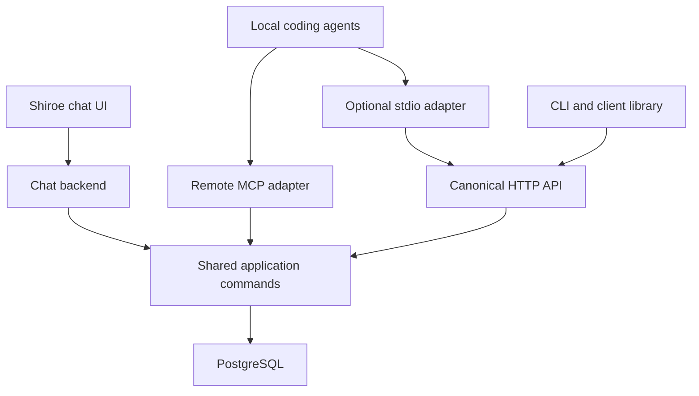

# Shiroe Phase 0: Access and Deployment Tooling

**Verification date:** 13 October 2026. **Status:** research and provisional architecture; no Shiroe implementation or live client interoperability test was performed.

## Recommendation

Build **one Shiroe application with an authenticated, versioned HTTP API, an in-process MCP adapter, and PostgreSQL persistence**. Make the CLI and client library ordinary API clients. Serve a small Shiroe chat UI from the application; keep model credentials and tool execution on its backend. Use remote Streamable HTTP MCP directly where supported, with an on-demand local stdio-to-API adapter only where needed. Start with one application instance on an approved persistent server.

This satisfies the architectural shape of the completion gate without selecting a programming language, provider, budget, or institutional network policy. It does **not** establish that the gate has passed: that requires the distributed tests below, using actual installed clients and the intended HPC site.

The main decision is whether “chat UI” means **Shiroe's own interface** or also requires **ChatGPT/Claude browser integrations**. The former can use the same private service as CLI clients. The latter introduces provider-side network access, product-specific authentication, and account/workspace availability requirements. A laptop's VPN or SSH tunnel does not automatically make a private service reachable from a hosted provider.

### Relationship to the attachments

The supplied vision treats Shiroe as persistent research state spanning literature, projects, and experiments. Development-plan sections 0.5–0.6 explicitly require API, CLI, MCP, authentication, a library, central deployment, local development, and four machine classes. Preserve the attachments' stable identity, provenance, epistemic distinctions, external artifact references, and schema evolution requirements.

The earlier survey's shortlist is primarily a **persistence/infrastructure shortlist**: PostgreSQL, JSONB, PostgreSQL FTS, optional pgvector, external artifact references, and thin access adapters. It does not shortlist FastAPI, Fastify, or Axum. The application frameworks compared here are additional candidates built around that shortlist, not recommendations attributed to the first report.

### Claims independently checked

| Earlier claim affecting this recommendation | Verification and consequence |
|---|---|
| PostgreSQL can own canonical structured state while JSONB handles evolving payloads. | Confirmed: relational constraints and JSONB are documented. JSONB does not replace referential integrity or revision semantics. Keep IDs, revision pointers, actors, and evidence links in constrained columns/tables. [S15, S16] |
| PostgreSQL transactions solve shared access. | Qualified: transactions provide the machinery, but do not automatically prevent application-level lost updates. Shiroe must implement revision preconditions, atomic commands, and retry receipts. [S17, S18] |
| PostgreSQL FTS can avoid a separate initial search service. | Confirmed: built-in text search and GIN indexes are documented. This supports an initial lexical baseline, not a claim that it meets every future retrieval-quality or latency requirement. [S48] |
| MCP revision 2026-07-28 is current. | Confirmed. Its HTTP behavior differs from 2025 revisions: protocol sessions and the old GET stream were removed. Do not copy old session assumptions into a new deployment. [S1] |
| MCP should be a thin adapter over shared logic. | Retained as architectural judgment. The protocol supports tools and resources; it does not enforce Shiroe's provenance, authorization, or persistence invariants. [S3, S4] |
| REST, MCP, and CLI can expose equivalent operations. | Feasible design, not demonstrated compatibility. Each client has its own transport/authentication/capability surface; see matrix and tests. |
| A central service separates clients from database credentials and artifact storage. | Supported as a pattern by current MLflow server documentation, including remote clients and separate metadata/artifact configurations. Shiroe still needs its own domain model. [S19] |
| Canonical state is recoverable through PostgreSQL backup. | Confirmed for database state: pg_dump produces consistent logical backups. It does not save external artifact bytes, identity-provider configuration, or deployment secrets. Test those separately. [S20] |

## 1. Client compatibility matrix

**D = documented in official documentation/specification. C = confirmed in source, but not exercised here. P = Shiroe prototype required. U = not established by the sources inspected.** “Writes” means the client can invoke a write-capable tool; it does not mean Shiroe writes already work. Product approvals and Shiroe authorization are separate controls.

### Required clients

| Client and connection origin | Transports and authentication | Tools, resources, and writes | Shiroe route | Unknowns / prototype checks |
|---|---|---|---|---|
| **Codex CLI, local runtime**; connections originate on its host | **D:** stdio and Streamable HTTP; bearer token and OAuth, including CIMD/DCR. Host config supports environment-backed tokens/headers and OAuth credential stores. [S5, S6] | Tools and write approval settings documented. **C:** resource listing, templates, and reading exist in current source. [S7] | Direct `/mcp`; local stdio adapter only if needed | **P:** exact protocol revision, resource exposure, auth refresh, actual write approvals, proxy/CA behavior on pinned CLI. Main-branch source is not proof for every released binary. |
| **Codex IDE/local desktop**; use the actual Codex host, which may differ from the visible UI machine | **D:** shares host MCP configuration with CLI; stdio/HTTP configuration documented. [S5] | Same documented host configuration surface; **P:** IDE/desktop presentation and permissions | Direct `/mcp` from that host | Identify where the extension/agent actually runs in SSH/remote development. A local browser or editor does not identify the network origin. |
| **Claude Code, local CLI**; connections originate on its host | **D:** stdio, HTTP, deprecated SSE; also WebSocket, with header-only auth. HTTP supports OAuth and headers; dynamic header helpers available. [S8] | **D:** tools, resources/@ references, prompts, and permission-controlled actions. Use tools for writes. [S8] | Direct HTTP `/mcp`; stdio adapter if site/client constraints require it | **P:** runtime generation, negotiated revision, provider-specific behavior, approval policy, token storage on headless HPC. WebSocket is unnecessary for Phase 0. |
| **Generic MCP client: official SDK test driver** | **D:** choose a pinned Python or TypeScript SDK; stdio/HTTP, auth hooks. Python HTTP client configuration carries headers, OAuth, proxies, and timeouts. [S9, S10] | **D:** tools and resources. Write calls can be driven deterministically | Direct `/mcp`; test stdio adapter separately | **P:** scripted login, pagination, error mapping, concurrent writes. “Generic MCP client” is not a universal compatibility promise; name the implementation/version. |
| **MCP Inspector** as a second, independent diagnostic client | Official Inspector has browser, CLI, and TUI clients; current docs require Node ≥22.19.0. [S11] | Tools/resources inspection and calls; test writes against disposable fixtures | Connect directly or to stdio adapter | Pin package version. Its browser UI may use a local proxy process: check reachability from that process, not merely the browser. Never expose its diagnostic proxy as Shiroe's public service. |
| **Shiroe CLI and API scripts** on laptop/workstation/server/HPC | **Proposed:** HTTPS JSON API, bearer token; optional approved proxy or SSH forwarding | Explicit read/write endpoints; no MCP dependency | `/api/v1/*` | **P:** CLI packaging, exit codes, credential storage, proxy/CA configuration, retry journal. REST transport is independent of MCP support. |
| **Shiroe client library** | **Proposed:** same HTTP contract and credential provider as CLI | Typed read/write methods; client checks are convenience, server checks are authoritative | Same API | **P:** old-library compatibility, unknown fields, timeouts, durable operation IDs; no database connections from clients. |

Codex exposes `mcp_oauth_credentials_store` choices `auto`, `file`, and `keyring`, plus bearer/environment header fields. Do not assume a keyring exists on every machine. Claude Code documentation describes secure token storage and refresh, but this review does not establish the effective backend on the intended HPC node. Verify file permissions and credential behavior there. [S6, S8]

### Hosted agents and browser chat interfaces

| Surface | Documented networking/authentication | Read/write and resource limits | Consequence for Shiroe |
|---|---|---|---|
| **Shiroe's own browser chat UI** | **Proposed:** browser reaches Shiroe over HTTPS/VPN/approved forwarding; backend authenticates user and performs tool calls | Can use the full canonical API; backend executes model-requested operations under user authorization | Preferred minimal UI. No requirement for a hosted provider to connect inbound to Shiroe. Model access/data-transfer policy remains a separate choice. |
| **ChatGPT browser plugins/custom MCP integration** | Public HTTPS Streamable HTTP or Secure MCP Tunnel is documented. Authenticated plugins use MCP-compatible OAuth; local Codex TOML is not browser configuration. [S5, S12, S13] | Write tools documented. General resources/template/subscription parity with local Codex is **U**; do not rely on it. [S14] | **P:** target account's connection setup, OAuth registration, approvals, and actual tools. Return useful data directly from read tools, not only resource URIs. |
| **Claude browser remote connector**, including account-brokered remote connectors in Desktop/Cowork | Requests come from Anthropic's cloud and need provider-reachable ingress. OAuth supports published identity, automatic registration, or provided client. Fixed request headers are documented, but the detailed docs mark them a limited-organization beta. [S21, S22] | Connector tools can act on services; exact MCP resource/prompt handling and negotiated revision are **U** | **P:** available account features, transport, read/write approvals. Do not assume fixed-header authentication is available to this researcher. Local Desktop extensions are a separate local mechanism. |
| **OpenAI Responses API remote MCP**; hosted tool execution | **D:** Streamable HTTP or HTTP/SSE; caller supplies `authorization`; tool filters/approval flow documented. [S23] | Tools are the documented interface; general MCP resources/prompts are **U** | OAuth login/refresh must be arranged by the calling application. A laptop localhost endpoint is not reachable from OpenAI. Test exact MCP revision. |
| **OpenAI Agents API** | **D:** HTTP from service (default), HTTP from session environment, or stdio in environment. Session credentials and service-side vault support have distinct boundaries. [S24] | Tool discovery/calls documented; resource parity **U** | Choose connection origin explicitly. Environment-origin HTTP can reach private services reachable from that executor. Do not generalize this feature to all Codex products. |
| **Legacy Codex Cloud environment** | Current docs label this surface legacy; agent networking is configurable. Setup-only secrets are removed before the agent phase. [S25] | Local CLI compatibility cannot be inferred from the cloud product | **U/P:** custom Shiroe MCP configuration in the actual target product. REST/CLI fallback also requires agent-phase credentials and reachability. Do not bake credentials into repository files during setup. |
| **Claude managed/API agents via MCP tunnels** | Official tunnel docs expose private servers to Managed Agents and Messages API, explicitly excluding claude.ai connectors. [S26] | Upstream authentication and selected hosted API behavior require their own test | Optional provider-specific integration. The ordinary Messages MCP connector page could not be fully fetched in this review; its complete feature matrix remains unverified. |

**Important distinction:** configuring a local server in Claude Desktop, or a local MCP in Codex, does not make it available to the corresponding hosted chat product. Network origin, installed configuration, and credentials must each be checked independently.

### Protocol and version ledger

| Component | Version/revision observed on verification date | Interpretation |
|---|---|---|
| MCP | **2026-07-28** current; **2025-11-25** relevant legacy revision | New request metadata/discovery and HTTP rules; legacy compatibility must be deliberate. [S1, S2] |
| Codex CLI | **0.162.1** latest stable shown; 0.163.0 alpha releases also present | Candidate test pin, not a tested Shiroe client. Resource code reviewed on `main`; check stable binary separately. [S27, S7] |
| Claude Code | Current rolling docs specify v2 runtime from **2.1.232** with feature flags, default in no-feature-flag sessions from **2.1.274** | Capture `claude --version`, runtime generation, and negotiated revision; version alone is insufficient. Current docs also describe a legacy runtime. [S8] |
| Official Python MCP SDK | **2.3.0** release; Python **≥3.11** in inspected metadata | v2 uses `MCPServer`; older `FastMCP` snippets are version-specific. Docs describe serving old and new protocol eras. [S9, S28] |
| Official TypeScript MCP SDK | **2.3.1** server/client/core releases; v1 maintenance line also exists | v2 packages differ from old `@modelcontextprotocol/sdk` examples. [S10, S29] |
| Rust MCP SDK `rmcp` | **3.5.1** | Current source targets 2025-11-25 and 2026-07-28; no standalone 2024 HTTP+SSE transport. [S30, S31] |
| PostgreSQL | **18** documentation used | Choose a supported institutional version; no dependency on an unproven PG18-only feature in this proposal. |
| Application candidates | FastAPI **0.143.0**, Fastify **5.x** documented line, Axum **0.8.9** | Observed versions, not a resolved dependency lock. [S32–S35] |
| HTTP/API standards | RFC **9110**; OpenAPI **3.1.1** used as an explicit contract target | Pin a schema dialect supported by clients; do not require newest OpenAPI merely because it exists. [S18, S36] |

For every prototype run, retain OS/architecture, client versions, SDK lockfiles, application revision, database version, auth mode, MCP revision, runtime flags, and endpoint reachability. Hosted-product capability has no reliable local package version; record account/workspace and test date.

## 2. Minimal access architecture



MCP, HTTP, chat backend, and application commands are **modules of one deployment**, not separate services. The local adapter is a client child process and has no canonical store. The UI's LLM integration can remain minimal until its provider/model is chosen.

### Canonical API and common logic

Provisional endpoints:

| Interface | Purpose |
|---|---|
| `GET /api/v1/capabilities` | API range, supported payload schemas, feature flags; restrict deployment-sensitive details |
| `GET /api/v1/objects/{id}` | Latest object envelope plus revision/precondition token |
| `GET /api/v1/objects/{id}/revisions/{revision_id}` | Immutable historical representation |
| `GET /api/v1/search?q=...&cursor=...` | Authorized bounded retrieval, stable IDs/revision IDs |
| `POST /api/v1/objects` | Create an object with stable creation identity and operation ID |
| `POST /api/v1/objects/{id}/revisions` | Append a validated revision conditional on current revision |
| `POST /api/v1/relations` | Add a typed relation and provenance atomically |
| `GET /api/v1/operations/{operation_id}` | Authorized receipt lookup after uncertain network outcome |
| `/mcp` | Tools and optional resources over Streamable HTTP |
| `/ui` and `/chat/*` | UI and authenticated chat execution; not another persistence implementation |

Define application commands such as `GetObject`, `Search`, `CreateObject`, `AppendRevision`, and `AddRelation`. Each takes a normalized principal plus typed input. **All command handlers revalidate inputs and enforce permissions**, even when an MCP SDK, OpenAPI-generated client, or browser has already checked them.

Canonical objects include stable IDs, immutable revision IDs, type, payload schema version, epistemic category, provenance references, author/acting principal, and timestamps. Record authenticated actor independently from client-reported model/harness metadata; the latter is useful provenance but not trusted identity. Evidence should point to immutable revisions when interpretation depends on a particular state.

HTTP and MCP adapters normalize their requests into these commands and map results/errors back. Central MCP calls commands in-process; the stdio adapter calls HTTP. Avoid a same-process MCP-to-REST loopback hop unless sharing an independently deployed API actually requires it. Authorization cannot live only in REST middleware, because in-process MCP/chat would bypass it.

### Authenticated API approaches

| Approach | Advantages | Limits / when to choose |
|---|---|---|
| **Scoped opaque Shiroe tokens over TLS** | Small baseline; works with local agents, API scripts, CLI, and header-configurable MCP clients | Need issue/revoke/expiry/token-hash management and per-token principal/scopes. Native hosted browser auth is not universally header-configurable. Fits an initial single-researcher pilot if policy permits. |
| **OAuth resource server with an established issuer** | User login, short-lived access, stronger account attribution, hosted-client integration | Existing institutional OIDC is not automatically MCP-compatible. Check protected-resource metadata, PKCE, audience/resource parameters, registration, redirect rules, and scope mapping. Best if approved identity infrastructure already exists or hosted chat is mandatory. |
| **Browser session authentication** | Same-origin UI can keep tokens out of browser JavaScript | UI session auth still maps to the same principal/permissions; add CSRF protection and secure cookies. It is not authentication for external MCP clients. |
| **SSH/VPN/network allowlisting alone** | Useful reachability controls | Insufficient as Shiroe's user/tool authorization. Retain application authentication across tunneled connections. |

**Baseline proposal:** scoped tokens for Phase 0 clients; an authenticated UI session established through an approved existing login mechanism, or an explicitly provisioned pilot credential. Do not invent a full OAuth issuer merely to avoid choosing an identity provider. Add OAuth when a chosen client or institution requires it. Hosted ChatGPT integration is a concrete reason, not a universal prerequisite for Shiroe's own UI.

For OAuth MCP, the current spec requires protected-resource metadata and authorization-server discovery; CIMD is preferred and DCR is deprecated but retained. OAuth 2.1 is referenced as an IETF draft, not a final RFC. Validate access-token audience and issuer, expiration, and granted scopes. Do not reuse a model-provider API key as a Shiroe credential or forward a Shiroe token to unrelated services. [S2]

Choose canonical API and MCP resource identifiers explicitly. A token for `/mcp` must not automatically authorize `/api/v1` merely because both share a host. Either the issuer deliberately authorizes both as one defined resource, or each adapter validates its own audience then maps to the common internal principal. Tokens from different issuers must not collide on an unqualified `sub` value.

Suggested initial authorization is small: `knowledge:read`, `knowledge:write`, and owner-only administration, intersected with project/corpus membership. Check object access, relation endpoints, search results, resource lists, and receipt retrieval. Scope alone is insufficient for a cross-project knowledge store. A write tool exposed by a host, or approved by a person, cannot widen server permissions.

Keep tokens outside committed TOML/JSON, shell history, tool arguments, logs, and ordinary model context. Prefer an OS credential store where available; otherwise use a permission-restricted user file and documented loading. Environment-backed headers avoid hardcoding secrets in shared config, but environment variables are still credentials. Treat shared HPC home storage and copied config files as part of the credential-handling design.

### MCP surface

Expose a small tool set: `shiroe_get_object`, `shiroe_search`, `shiroe_create_object`, `shiroe_append_revision`, `shiroe_add_relation`, and `shiroe_get_operation`. Keep read operations available as tools because not every hosted client exposes resource APIs. Provide optional resources such as `shiroe://objects/{id}/revisions/{revision_id}` for clients that do; include essential IDs/provenance directly in tool results. A resource URI is an identifier, not a credential or guarantee that the client can dereference it outside MCP. [S3, S4]

Use the official SDK's version compatibility rather than hand-writing JSON-RPC. Support the 2026-07-28 path and required legacy 2025 paths, then record what each client actually chooses. Python v2 documents dual-era support; TypeScript v2's default legacy HTTP handling is stateless and legacy GET/DELETE return 405. If a pinned client needs sessionful legacy behavior, adapt the SDK configuration inside the same application. Add the old two-endpoint SSE transport only if a required client fails without it. [S9, S37]

Prefer short request/response tools. Do not require subscriptions, sampling, elicitation, notifications, or long-lived streams for knowledge correctness. Streaming SSE responses within Streamable HTTP are distinct from the deprecated standalone HTTP+SSE transport. Set read/write tool annotations accurately, but do not assume annotations implement authorization or deduplication.

### CLI and library

Build a thin CLI with `get`, `search`, `create`, `revise`, `relate`, `operation`, `doctor`, and `version`. Offer JSON output, bounded pagination, stdin/file request input, deterministic exit codes, explicit profiles, connect/read timeouts, proxy/CA settings, and a small mutation journal. `doctor` should diagnose DNS/TLS/auth/API version without printing secrets.

Maintain one initial library language based on actual research scripts and team preference; do not ship three SDKs just because the server candidates use three languages. A Python library may suit Python workflows even with a Rust or TypeScript server, but that remains a researcher choice. OpenAPI can generate transport bindings; a small handwritten wrapper should handle credentials, operation IDs, retries, and domain errors. Transport code generation does not generate correct mutation semantics. [S36]

The local adapter may be `shiroe mcp-stdio --profile central`. It should launch from a pinned installation, emit protocol messages only on stdout, send diagnostics to stderr, load user credentials, and forward the same command envelopes to HTTP. Install it in user space; avoid requiring `npx -y` or `uvx` to download code during every HPC session. No background daemon, local database, or local synchronization service is necessary.

## 3. Shared writes, retries, and schema evolution

### Mutation contract

The following are **proposed Shiroe guarantees**, not properties supplied automatically by HTTP or MCP:

1. Each logical write carries an `operation_id`, expected revision for updates, and stable creation identity for new objects. The CLI/library persists these **before** sending. MCP write schemas carry these explicitly, since native hosts may not let Shiroe inject per-call HTTP headers.
2. The service authenticates and authorizes the command, including target membership. It normalizes inputs and fingerprints the command type, target, payload, schema version, provenance, and revision precondition.
3. In one PostgreSQL transaction, it claims a receipt key unique on `(principal, operation_id)`, conditionally advances the object's current revision, inserts immutable revision/provenance/relations, updates any transactional retrieval projection, and stores the result receipt.
4. Concurrent use of the same receipt key is serialized by the database constraint. An identical retry returns the original committed result; changed content with the same key returns a conflict. Lookup precedes treating the old expected revision as a new-write conflict, so a successful retry still works after another revision is appended.
5. Updates use compare-and-swap or row locking with a revision check. Only one writer can advance the same expected revision; the other receives a conflict and must reread. PostgreSQL's normal isolation does not replace this check. For multi-object invariants, lock consistently or use serializable transactions with bounded internal retry. [S15, S17]
6. Authorize receipt replays again. Revoked access must not reveal an old result merely because its receipt exists. Commit before acknowledging success; a connection drop after commit does not undo the write.

For HTTP, a strong ETag/`If-Match` contract can express the revision precondition if the ETag truly identifies the selected representation. Use 412 for a failed HTTP precondition and a stable domain code such as `revision_conflict`; otherwise use an explicit `expected_revision_id` with 409. Do not mix inconsistent preconditions. MCP returns the same domain code in a tool error with any authorized current-revision information. RFC 9110 defines conditional requests and warns against automatic retry of non-idempotent methods without knowledge that retry is safe. [S18]

**Duplicate prevention is bounded.** Reusing the logical operation ID prevents a second database effect. A JSON-RPC request ID, MCP session ID, tool annotation, or reconnect does not establish that identity. A model inventing a different operation ID for the same intention remains a new request. Required update preconditions stop many accidental repetitions; stable create IDs and domain uniqueness rules help creations. Semantic similarity must not silently deduplicate distinct scientific observations.

If native hosts cannot reliably preserve operation IDs, prototype a small server-issued write-intent/commit-token workflow. It adds a tool interaction, not an infrastructure service. Require the same commit token on retries. Even that does not identify two independently prepared intentions as duplicates; decide whether that risk is acceptable before claiming agent retry safety.

Keep receipts for a declared retry horizon; after expiration, reject expired operation identities or retain tombstones rather than silently accepting an old retry as new. Document whether failed commands consume operation IDs. For a timeout, query the receipt or resend the exact envelope; do not mint a fresh key. Retry transient transport errors/429/selected 5xx with bounded exponential backoff and jitter; honor Retry-After. Do not automatically retry validation, authorization, or revision conflicts. Cancellation is not proof that a write rolled back.

### Evolution without breaking clients

Keep four version axes distinct:

| Version axis | Provisional policy |
|---|---|
| HTTP contract | `/api/v1`; additive compatible changes within v1, explicit new major interface for incompatible changes |
| Domain payload schema | `schema_version` in each revision; publish supported types/versions, validate new submissions explicitly |
| MCP protocol | SDK negotiation/compatibility; independent from Shiroe API and payload versions |
| Database schema | Reviewed, numbered migrations; clients never see internal tables |

Freeze the object envelope, pagination/error conventions, operation IDs, and revision semantics before the literature layer. Permit optional response fields; clients tolerate them. Treat enum additions, renamed tool arguments, stricter validation, required fields, and changed nullability as potentially breaking. Reject unsupported write schemas clearly; never reinterpret an old write under new meaning.

Preserve historical revisions as evidence. A migrated current representation can coexist with original historical schema/payload and explicit transformation provenance. MCP tools call versioned application commands; keep an older tool's semantics or introduce a new named version when needed. Publish OpenAPI/JSON schemas and run old-client fixtures against each release. Disable shared caching of private mutable results unless principal and revision boundaries are correct.

Use backward-compatible database migrations so an application rollback remains possible. Run migrations once as a deployment action, not simultaneously from every worker. Backup before destructive migration and verify restore. Phase 0 does not need zero-downtime rolling deployments unless availability requirements demand them.

## 4. Deployment and HPC reachability

### Practical deployment options

| Mode | Minimum arrangement | Tradeoffs and requirements |
|---|---|---|
| **Local development** | Same application + local PostgreSQL; loopback binding; disposable auth/test credentials | Same database engine and API semantics as central mode. Containers via Compose are convenient if allowed; native PostgreSQL/application processes are an alternative. Local stdio adapter still calls the local API. |
| **Approved persistent server/VM** | One app instance + PostgreSQL, persistent disk, HTTPS, restart supervision, backups | Recommended initial topology. Institution-hosted or external VM are both plausible. Owner must maintain OS/runtime, certificates, storage, and recovery. No exact provider/cost assumed. |
| **Managed app + managed PostgreSQL** | Same app image/contract, managed persistence, private DB networking | Less operational work, recurring cost and data-location constraints. Verify request timeout, SSE handling, shutdown, database pooling, and idle/sleep behavior. |
| **Rootless/user-managed server installation** | High application port, approved TLS ingress, user-space runtime; separately approved database | Possible when containers/root unavailable. User service supervision may require administrator-enabled persistence; SSH logout survival alone is not dependable operations. |
| **Workstation-hosted pilot** | Persistent workstation app/DB and an approved access path | Can demonstrate access, but sleep, reboot, NAT, and availability may fail a meaningful central deployment requirement. Accept only with explicit researcher agreement. |
| **HPC login node as central server** | Depends on site permission, ingress, storage, and service rules | Not the default. The login node is a required client, not evidence it is an appropriate server. Short CLI/adapter processes are the simpler target. |

Compose supports a single-server production arrangement; Kubernetes is not required. Caddy is one optional TLS terminator if approved ingress does not already exist. Its certificate issuance has DNS/network prerequisites; a private host needs an appropriate institutional CA or other valid certificate arrangement. Neither Docker nor port 80/443 access is assumed. [S38, S39]

Keep the database off public/client networks. Use a bounded connection pool, unprivileged application runtime, explicit trusted proxy/Host/Origin configuration, health/readiness checks, and redacted request IDs. TLS ingress must preserve authorization and MCP headers, body sizes, content types, and streaming behavior where used; do not redirect machine requests into an interactive HTML SSO page. Existing institutional ingress is preferable to introducing another gateway.

Persistent disk is not backup. Save database backups outside the primary failure domain, deployment configuration separately, and restore into a fresh environment. A named container volume alone does not survive loss of its host. External artifact URIs are references: a successful API read does not prove that a laptop can read an HPC filesystem artifact. Return availability/reference metadata without promising universal artifact access. [S20]

### Site-specific HPC checks

No universal HPC restriction is assumed. Official examples demonstrate why site verification matters: NERSC documents login-node limits **and** supported workflow mechanisms; OLCF's Citadel environment explicitly blocks internet access from login/compute resources. Neither establishes Tuolumne's or another site's rules. [S40–S42]

| Possible constraint | Verify on the intended login node | Minimal adaptation |
|---|---|---|
| Outbound HTTPS blocked or allowlisted | DNS resolution, TLS connection to chosen service, authenticated request; obtain endpoint policy | Approved allowlisting or place central service on a permitted institutional network |
| HTTP proxy required | Proxy URL, CONNECT support, authentication, NO_PROXY rules, certificate trust | Explicit CLI/library proxy and CA configuration; test native agent separately |
| HTTP/SSE buffering or timeout | Short JSON MCP response, optional SSE response, timeout under actual proxy | Short bounded tools/JSON response mode where SDK/client supports it; no required notifications |
| No administrator privileges | Python/Node/binary availability, user package installation, executable mount, libc/architecture | Pinned venv/user installation, offline wheels, or compatible prebuilt binary |
| Package registries unreachable | Whether dependencies can be installed through an approved route | Pre-stage locked dependencies; avoid runtime downloads |
| Browser/loopback OAuth callback inaccessible | Browser login, callback forwarding, redirect URI policy | Scoped token; device flow if the chosen issuer/client supports it; documented manual callback path where available |
| Long-lived/background services limited | Login-process policy, session lifetime, resource accounting | Short-lived CLI and stdio child; central service elsewhere |
| SSH forwarding restricted | Approved bastion route, forwarding permissions, MFA/session expiry | Authorized scoped tunnel, or an institutional service endpoint; never assume SSH access implies forwarding permission |
| Credentials on shared home/storage | Keyring availability, permissions, backup/copy exposure | Restricted credential file or approved credential mechanism; expire/revoke pilot tokens |
| Agent/model provider inaccessible | Provider endpoint and policy separate from Shiroe endpoint | CLI/API still work; approved locally served model/harness may be needed |

HTTPX documents proxy environment variables and custom CA settings; the current Python MCP SDK puts HTTP configuration on its `httpx2` client. Other runtimes must be tested rather than presumed to honor the same variables. [S43, S44]

### Approved tunnels: direction and limits

An SSH **local forward opened on the HPC node** can expose a permitted remote service at HPC loopback. A forward opened on a laptop creates a laptop listener, not an HPC listener. SSH manual options `-L`, `-R`, and `-D` have distinct directions and behavior; bind loopback explicitly. [S45]

For an approved TLS service reachable from a bastion, an illustrative forward is:

```bash
ssh -N -o ExitOnForwardFailure=yes \
  -L 127.0.0.1:18443:shiroe.example.edu:443 user@approved-bastion.example.edu
```

This command is **a proposed pattern, not verified site permission**. The SSH client must run where the listener is needed. Keep the original TLS hostname/SNI when routing to that listener. An HTTP probe can use `curl --connect-to shiroe.example.edu:443:127.0.0.1:18443 https://shiroe.example.edu/api/v1/capabilities`; production CLI needs equivalent transport routing or an approved hostname-preserving SOCKS/proxy arrangement. Merely changing the URL to `https://localhost:18443` generally breaks certificate/audience expectations. Do not disable certificate verification.

A reverse forward could expose a server through a login connection, but changes the exposure direction and needs explicit site permission. Do not use it as a default central deployment. If no authorized route reaches the same server, online access cannot pass the gate. Export/import is useful transfer functionality, but is not equivalent to shared live access.

**Provider tunnels are conditional alternatives:** OpenAI documents an outbound-HTTPS tunnel client with proxy/custom-CA support for supported products; it still needs an approved persistent host, runtime key, product permissions, and local server reachability. Anthropic's tunnel documentation explicitly separates API/Managed Agents access from claude.ai connectors. Neither is a provider-neutral Shiroe access layer. [S46, S26]

## 5. Small tooling shortlist

All three server candidates retain PostgreSQL, JSONB for evolving payloads, ordinary relational invariants, and initial FTS from the first survey. None needs a second persistence service for Phase 0. Framework throughput rankings are not a meaningful selector without a measured Shiroe bottleneck.

| Candidate server stack | Documented fit | Tradeoffs / selection condition |
|---|---|---|
| **Python: FastAPI + Pydantic + official MCP SDK v2** | FastAPI exposes OpenAPI and validation; MCP SDK documents ASGI mounting and dual-era protocol support. [S32, S9] | Strong candidate if Python is the team's preferred integration language. Keep authoritative domain validation shared beneath both adapters; mounting auth/lifespan needs a prototype. Runtime/dependencies must be available on server; CLI can have a separate smaller dependency set. |
| **TypeScript: Fastify + official MCP SDK v2** | JSON Schema validation/serialization; official SDK has a documented Fastify adapter. [S33, S47] | Strong candidate if UI/Node development dominates. Reuse a schema representation without allowing HTTP and MCP validation to drift. Current v2/legacy package distinctions and header forwarding must be pinned/tested. |
| **Rust: Axum + Serde/schema generation + rmcp** | Axum integrates Tower middleware; rmcp supplies mountable Streamable HTTP and stdio. [S35, S31] | Strong candidate if maintainers prefer Rust or deployable binaries materially simplify client distribution. More explicit API/schema/auth assembly; test resource-server middleware and old/new protocol paths. Binary compatibility and build targets still need verification. |

**Conditional recommendation:** choose the language the maintainers can support best, then prototype that stack against the fixed access/concurrency contracts. With comparable familiarity, Python favors literature-tool integration, TypeScript favors a substantial custom UI, and Rust favors a binary-centered deployment approach. These are engineering judgments, not benchmark findings. No language selection is settled by this report.

A full Django/DRF application is another reasonable route if an admin UI/user-management requirement emerges, but that is not yet demonstrated; compare it then rather than adding a fourth implementation now.

| Other tooling | Phase 0 disposition |
|---|---|
| PostgreSQL migrations and logical backup | Required capability; choose language-appropriate migration tooling and pg_dump/restore. An ORM is optional. |
| OpenAPI contract + one thin library/CLI | Recommended; generate bindings only where useful and keep retry semantics explicit. |
| MCP Inspector + independent official SDK test driver | Recommended validation tools, not production gateways. |
| Compose or native supervised processes | Both viable; select based on host permissions. |
| Existing institutional OAuth/OIDC issuer | Prefer if it can satisfy chosen clients. Verify MCP discovery/registration/audiences first. |
| New self-hosted identity service or managed identity provider | Conditional: justify with multi-user/hosted-chat requirements, cost, and approved policy. No default product chosen. |
| Caddy / existing institutional ingress | Optional TLS termination; use existing ingress when available. |

### Rejected or deferred alternatives

- **MCP-only persistence/API:** insufficient for ordinary CLI clients and a stable domain contract; client feature differences would dictate Shiroe semantics.
- **Generic remote-MCP gateway as a required service:** native HTTP support covers the required coding clients. A small local adapter handles exceptional environments without another deployment.
- **Direct database access from clients:** bypasses authorization, provenance, validation, and migrations; distributes database credentials.
- **Git or per-machine SQLite synchronization as the knowledge store:** does not meet the proposed canonical transactional boundary. Keep Git/artifact references, not a parallel writable truth.
- **MLflow as Shiroe's whole server:** useful experiment-tracking integration and architectural precedent, but mapping arbitrary claims/contradictions/revisions into tracking objects is an additional domain abstraction. Not justified for Phase 0. [S19]
- **Letta/Mem0 as the owner of truth:** this recommendation does not depend on the first survey's particular product criticisms. Even without those claims, selecting agent-memory infrastructure would still require demonstrating Shiroe's epistemic/provenance/revision contracts; the Phase 0 gate does not require their agent execution/memory features.
- **pgvector, OpenSearch, graph DB, Redis, broker, object-upload service:** defer until retrieval, coordination, durable work, or artifact ownership demonstrates a requirement. Store artifact references now.
- **Kubernetes, service mesh, multi-region replication:** no demonstrated availability/scale requirement. A single server is an intentional initial failure domain, not a promise of HA.
- **WebSocket/custom MCP transport:** no required client/workflow demands it. Short knowledge requests fit HTTP.

## 6. Concrete end-to-end flows

Endpoint names and command syntax below are **provisional API designs**, not working commands for an existing Shiroe installation.

### A. Coding agent appends a research interpretation

1. On a workstation, configure Codex with the central MCP URL and an environment-backed Shiroe token, or complete MCP OAuth login against an approved issuer. Claude Code uses its separately documented HTTP configuration/authentication. Client login to its model provider is independent.
2. The client discovers supported tools using its negotiated MCP revision. Shiroe authenticates discovery and filters the available surface. `shiroe_get_object` returns object `claim:C392`, current revision `rev:R7`, epistemic category, and immutable evidence references.
3. The agent drafts an interpretation labeled `inferred`, referencing the exact evidence revision. The harness/client establishes `operation_id=op:W123` and preserves it before a write; if the native host cannot do this reliably, use the proposed write-intent fallback rather than assume deduplication.
4. It calls `shiroe_append_revision` with object ID, `expected_revision_id=rev:R7`, operation ID, payload schema version, interpretation, and provenance. The host applies its own write approval policy.
5. MCP maps the request to `AppendRevision(principal, command)`. The common handler validates the epistemic category/evidence, checks write permission, and atomically creates `rev:R8` plus provenance and the operation receipt.
6. The tool returns stable object/revision/operation IDs, commit timestamp, and concise structured/text output. If the connection drops, the client checks `shiroe_get_operation(op:W123)` or repeats the identical tool arguments. A retry returns `rev:R8`; it does not append `rev:R9`.
7. A laptop API client and the HPC CLI read `claim:C392` and observe `rev:R8`. If another writer advanced R7 first, this write conflicts; the agent must retrieve current state and deliberately revise its proposal.

Example Codex host configuration, with no literal secret:

```toml
[mcp_servers.shiroe]
url = "https://shiroe.example.edu/mcp"
bearer_token_env_var = "SHIROE_TOKEN"
```

The documented configuration fields are current; actual login, environment loading, permissions, and protocol revision remain prototype checks. [S6]

### B. HPC CLI records an observation

1. Install a pinned CLI/library in user space, with credentials in an approved restricted store. Run a small `doctor` probe from the actual login node. Determine direct HTTPS, institutional proxy/CA, or an explicitly approved tunnel route.
2. Fetch the relevant project/object and current revision. Create a request file containing `observed` data, input/config provenance, and an external artifact reference with digest where available. Do not claim that a path alone identifies immutable evidence.
3. The CLI generates or accepts a stable creation ID and operation ID, journals the exact command locally, and sends `POST /api/v1/objects` with authorization and `Idempotency-Key` mapped to that operation ID. This header is a proposed Shiroe convention, not a guarantee from RFC 9110. An API caller can use the same envelope; MCP maps its explicit argument to the same receipt namespace.
4. The central service authenticates the caller, validates schema/provenance and membership, commits object/revision/receipt in PostgreSQL, then returns 201 with stable IDs. CLI prints machine-readable JSON and exits successfully.
5. If the reply is lost after commit, the CLI preserves the journal, queries `/api/v1/operations/{operation_id}`, and/or retries the exact envelope. If offline, it reports an uncertain/unsubmitted operation, not fabricated success. A queued local file is not canonical knowledge.
6. Claude Code on the workstation retrieves the same observation through MCP, and the Shiroe UI displays the same revision/evidence. Restart the server and repeat the read from all machines.

Illustrative CLI contract:

```bash
shiroe --profile central doctor
shiroe --profile central create --file observation.json --json
shiroe --profile central operation get op:H456 --json
```

For an update, use the previously fetched revision precondition. The retry must keep the original payload and key. Editing the request file constitutes a new intention and should require a new operation ID.

### C. Shiroe chat UI

The browser establishes an authenticated same-origin session and submits a question to `/chat`. The backend retrieves authorized state and sends only relevant permitted evidence to the chosen model. Model tool requests execute through the same application commands under the user principal. Writes use the same operation/revision envelope and the UI's chosen confirmation policy. The model API secret stays server-side. Chat transcript persistence is optional; committed research objects remain authoritative even after a transcript is deleted.

This requires outbound access from the chat backend to the selected model service, or access to an approved local model. It does not require the model provider to reach Shiroe's private endpoint.

## 7. Compact integration test plan

Use one remotely hosted persistent store, a tiny corpus/project fixture, two user identities, read-only/write tokens, and immutable evidence references. **No performance target, scale, or budget is presumed.** Agree latency and expected concurrency before measuring them.

### Machine/client allocation

| Machine | Required test roles |
|---|---|
| Laptop | Codex CLI plus Shiroe UI/API reader |
| Workstation | Claude Code plus independent API client |
| Remote server | Central deployment plus separate SDK/generic MCP client process |
| HPC login node | Shiroe CLI/library over the actual approved route; optional stdio adapter if needed |

This covers the required client/machine sets without imposing every client on every machine. If “Codex on the HPC login node” is itself required, add it explicitly and test model-provider reachability independently. Hosted browser integrations are additional acceptance tests if chosen; a local-agent pass must not be reported as a hosted-product pass.

| Test | Procedure | Pass signal |
|---|---|---|
| **T1 Discovery/authentication** | Run each required client with pinned versions; record negotiated MCP revision, tools/resources actually visible, transport and route. Probe bad/expired credentials | Authorized clients work; bad credentials rejected; supported/unsupported features recorded without silent fallback |
| **T2 Cross-machine visibility** | Codex writes object A; Claude Code reads/revises A; generic MCP client adds a relation; HPC CLI writes B; laptop API reads B and relation; remote library reads all | Exact object/revision/provenance IDs agree across interfaces; no manual synchronization |
| **T3 Persistence** | Disconnect every client; restart application and PostgreSQL; reconnect from all four machines | Committed records/history/receipts survive and are readable by ID |
| **T4 Authorization parity** | Attempt read-only writes and cross-project reads/relations/search/resources/receipt retrieval through API, MCP, chat and stdio adapter | Equivalent denial everywhere; no protected content in discovery/results/errors |
| **T5 Competing revisions** | Barrier-release 10 requests from at least two machines updating the same base revision | Exactly one succeeds, nine conflict, no overwritten or orphaned revisions; arbitrary “10” is a small test fixture, not a scale requirement |
| **T6 Duplicate/concurrent retries** | Submit identical operation key/envelope in parallel; drop response after commit; restart and retry; reuse key with changed body | One mutation/receipt; same result replay; changed-body conflict; different-key semantic duplicates identified as outside guarantee |
| **T7 Partial failure** | Interrupt database transaction before commit; cancel client during write; recover and query operation | No partial revision/provenance/receipt state; after uncertain outcome, receipt identifies commit or absence |
| **T8 Actual HPC path** | Test approved proxy/CA or tunnel, session expiry, disconnected retry, package installation without root; record relevant site policy | Authenticated reads/writes work; no required login-node daemon; no TLS bypass or unapproved route |
| **T9 Interface/schema evolution** | Run pinned old CLI/library and both agent clients after additive API/schema change and migration; submit an unsupported write schema | Old valid commands keep semantics; incompatible writes fail explicitly; historical evidence remains accessible |
| **T10 Restore** | Restore backup into a fresh deployment with preserved config/IDs; point clients there | Canonical IDs, revisions, relations, receipts, and provenance match; raw artifacts checked separately |
| **T11 UI** | Browser reads evidence and appends permitted interpretation through backend; inspect result through HPC CLI | Same shared store and validation; no model credential in browser; clear observed/inferred labeling |
| **T12 Hosted integration, if required** | Separately test chosen ChatGPT/Claude account/product, OAuth or available headers, provider reachability/tunnel and write confirmation | Actual provider-origin connection and write succeed; resources/unsupported capabilities listed honestly |

Use deterministic SDK/API calls for failure injection and concurrency, plus real agent prompts for tool discovery, evidence retrieval, and write behavior. Agent prompts alone cannot prove transactional guarantees. Inspect database counts/integrity using server-side test credentials; this is test administration, not normal client access.

**Completion evidence:** a saved run manifest and result table showing T1–T11 for the selected configuration, with transcripts/redacted logs for Codex and Claude Code, exact cross-client IDs, retry/concurrency evidence, restart/restore evidence, and site reachability results. T12 becomes mandatory if hosted chat is chosen. Until then, all Shiroe compatibility claims here remain design expectations.

## 8. Remaining decisions

### Researcher preferences that materially change the recommendation

| Decision | Why it changes the design |
|---|---|
| Own chat UI versus mandatory ChatGPT/Claude browser use | Determines whether provider ingress, OAuth registration, product tunnels, and account entitlements enter Phase 0 |
| Single researcher versus collaborators and project isolation | Changes identity provisioning, membership, token issuance, audit, and hosted shared-credential suitability |
| Preferred implementation/maintenance language | Selects the server/SDK/toolchain; does not change the canonical contract |
| Approved hosting location and data classification | Determines institution/private deployment, external VM/managed services, and what evidence can go to model providers |
| Budget and operational owner | Determines managed database/auth versus self-maintained server; no cost estimate is defensible without these |
| Actual HPC system and approved network routes | Decides direct HTTP, proxy, tunnel, package staging, and whether the gate is currently feasible |
| Approved identity provider / existing institutional SSO | Determines whether OAuth is inexpensive integration or substantial infrastructure; verify MCP suitability |
| Required offline behavior | Queueing commands differs from offline reading/editing/synchronization; the latter expands Phase 0 significantly |
| Availability, backup RPO/RTO, concurrency, and dataset size | Determines whether a single server/logical backups remain sufficient; no HA requirement inferred |
| Acceptable native-agent write/retry workflow | Decides whether explicit operation IDs suffice or write-intent tokens need prototyping |
| Preferred script/client language and package installation policy | Determines initial library and HPC CLI packaging independently from server language |

### Hands-on checks still required

- Install/pin the chosen clients and prove tools, resource behavior, auth, and writes against a thin Shiroe fixture.
- Confirm target account/workspace feature access; Claude fixed request headers are a documented beta and cannot be assumed available.
- Check actual MCP versions and legacy/session requirements in Codex, Claude Code, and hosted clients; current official SDK capability is not end-product compatibility.
- Verify the chosen issuer's discovery, registration, resource/audience binding, redirect handling, and refresh behavior.
- Validate HPC policy and actual reachability with institutional documentation/support and a small authorized probe; no target-site policy was supplied here.
- Test shared authorization on mounted MCP routes, proxy header behavior, error mapping, and transaction/retry receipts before building higher-level intelligence.
- Resolve a dependency lock and deployment packaging; the observed version ledger is not a tested bill of materials.

## Sources

All references below are official documentation, standards, or first-party source repositories inspected on **2026-10-13**. Rolling documentation and `main` branches should be pinned/archived when creating the prototype manifest. Failed pages are explicitly identified above rather than treated as verified evidence.

- **S1:** [MCP 2026-07-28 Streamable HTTP specification](https://modelcontextprotocol.io/specification/2026-07-28/basic/transports/streamable-http).
- **S2:** [MCP 2026-07-28 authorization specification](https://modelcontextprotocol.io/specification/2026-07-28/basic/authorization).
- **S3:** [MCP resources specification](https://modelcontextprotocol.io/specification/2026-07-28/server/resources).
- **S4:** [MCP tools specification](https://modelcontextprotocol.io/specification/2026-07-28/server/tools).
- **S5:** [OpenAI: MCP in local Codex hosts and hosted ChatGPT](https://learn.chatgpt.com/docs/extend/mcp?surface=cli).
- **S6:** [OpenAI configuration reference](https://learn.chatgpt.com/docs/config-file/config-reference).
- **S7:** [Codex MCP resource tool definitions, source on main](https://github.com/openai/codex/blob/main/codex-rs/core/src/tools/handlers/mcp_resource_spec.rs).
- **S8:** [Claude Code MCP documentation](https://code.claude.com/docs/en/mcp).
- **S9:** [Official Python MCP SDK: v2 changes, mounting, and legacy support](https://github.com/modelcontextprotocol/python-sdk/blob/main/docs/whats-new.md).
- **S10:** [Official TypeScript MCP SDK v2 documentation](https://ts.sdk.modelcontextprotocol.io/v2/).
- **S11:** [Official MCP Inspector documentation](https://modelcontextprotocol.io/docs/2026-07-28/tools/inspector).
- **S12:** [OpenAI: connect and test a plugin](https://developers.openai.com/plugins/deploy/connect-chatgpt).
- **S13:** [OpenAI: MCP plugin authentication](https://developers.openai.com/plugins/build/auth).
- **S14:** [OpenAI: plugin security, permissions, and write tools](https://developers.openai.com/plugins/guides/security-privacy).
- **S15:** [PostgreSQL 18 constraints](https://www.postgresql.org/docs/18/ddl-constraints.html).
- **S16:** [PostgreSQL 18 JSON types](https://www.postgresql.org/docs/18/datatype-json.html).
- **S17:** [PostgreSQL 18 transaction isolation](https://www.postgresql.org/docs/18/transaction-iso.html).
- **S18:** [RFC 9110: HTTP semantics, conditional requests, and retries](https://www.rfc-editor.org/rfc/rfc9110.html).
- **S19:** [MLflow tracking server architecture](https://mlflow.org/docs/latest/self-hosting/architecture/tracking-server/).
- **S20:** [PostgreSQL 18 pg_dump](https://www.postgresql.org/docs/18/app-pgdump.html).
- **S21:** [Claude: remote connectors and cloud-origin networking](https://support.claude.com/en/articles/11175166-get-started-with-custom-connectors-using-remote-mcp).
- **S22:** [Claude: unlisted connectors, authentication, fixed-header beta, desktop extensions](https://claude.com/docs/connectors/custom/add-unlisted).
- **S23:** [OpenAI Responses API: remote MCP servers](https://developers.openai.com/api/docs/guides/tools-connectors-mcp).
- **S24:** [OpenAI Agents API: MCP connection origin and credentials](https://developers.openai.com/api/docs/guides/agents-api/tools/mcp).
- **S25:** [OpenAI: legacy Codex Cloud environments](https://learn.chatgpt.com/docs/environments/cloud-environment).
- **S26:** [Anthropic: MCP tunnels, supported products and limitations](https://platform.claude.com/docs/en/agents-and-tools/mcp-tunnels/overview).
- **S27:** [Codex releases](https://github.com/openai/codex/releases).
- **S28:** [Python MCP SDK releases](https://github.com/modelcontextprotocol/python-sdk/releases) and [runtime requirements](https://github.com/modelcontextprotocol/python-sdk/blob/main/pyproject.toml).
- **S29:** [TypeScript MCP SDK releases](https://github.com/modelcontextprotocol/typescript-sdk/releases).
- **S30:** [Rust MCP SDK releases](https://github.com/modelcontextprotocol/rust-sdk/releases).
- **S31:** [Official Rust MCP SDK: transports, mounting, protocol support](https://github.com/modelcontextprotocol/rust-sdk).
- **S32:** [FastAPI features](https://fastapi.tiangolo.com/features/) and [releases](https://github.com/fastapi/fastapi/releases).
- **S33:** [Fastify validation/serialization](https://fastify.dev/docs/latest/Reference/Validation-and-Serialization/).
- **S34:** [Fastify support/version policy](https://fastify.dev/docs/latest/Reference/LTS/).
- **S35:** [Axum 0.8.9 documentation](https://docs.rs/axum/0.8.9/axum/).
- **S36:** [OpenAPI 3.1.1 specification](https://spec.openapis.org/oas/v3.1.1.html).
- **S37:** [TypeScript SDK v2: legacy clients and transport behavior](https://ts.sdk.modelcontextprotocol.io/v2/serving/legacy-clients.html).
- **S38:** [Docker Compose single-server production use](https://docs.docker.com/compose/how-tos/production/).
- **S39:** [Caddy automatic HTTPS prerequisites](https://caddyserver.com/docs/automatic-https).
- **S40:** [NERSC resource usage/login node policy](https://docs.nersc.gov/policies/resource-usage/).
- **S41:** [NERSC workflow service mechanisms](https://docs.nersc.gov/jobs/workflow/).
- **S42:** [OLCF Citadel/SPI networking restrictions](https://docs.olcf.ornl.gov/spi/index.html).
- **S43:** [HTTPX proxy and CA environment configuration](https://www.python-httpx.org/environment_variables/).
- **S44:** [Current Python MCP SDK client transports](https://py.sdk.modelcontextprotocol.io/client/transports/).
- **S45:** [OpenSSH manual: local, remote, and dynamic forwarding](https://man.openbsd.org/ssh).
- **S46:** [OpenAI Secure MCP Tunnel](https://developers.openai.com/api/docs/guides/secure-mcp-tunnels).
- **S47:** [TypeScript MCP SDK: Fastify integration](https://ts.sdk.modelcontextprotocol.io/v2/serving/fastify.html).
- **S48:** [PostgreSQL 18 full-text search](https://www.postgresql.org/docs/18/textsearch.html) and [preferred index types](https://www.postgresql.org/docs/18/textsearch-indexes.html).

